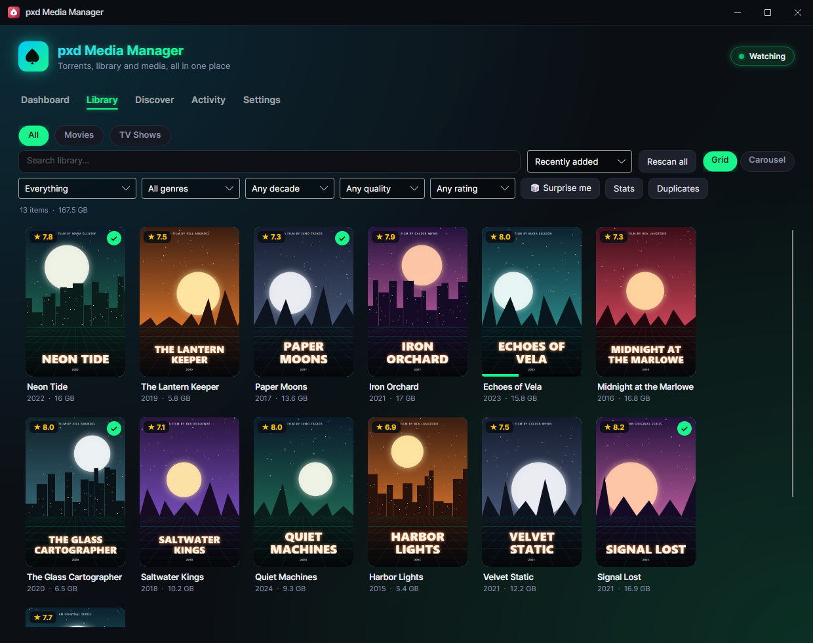
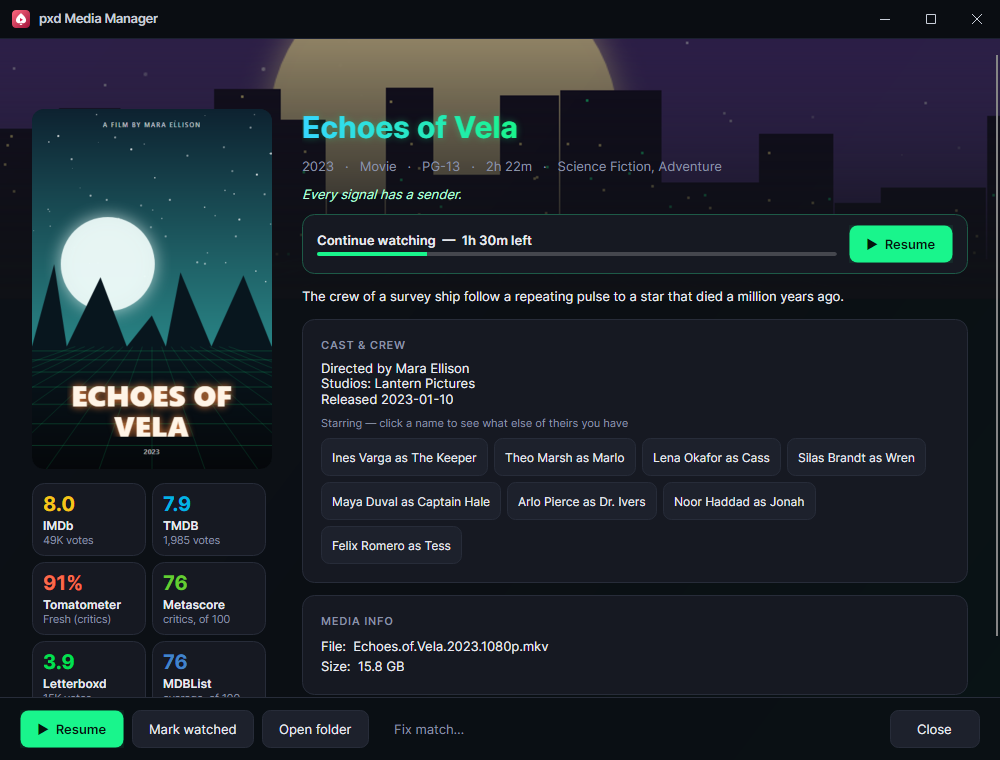
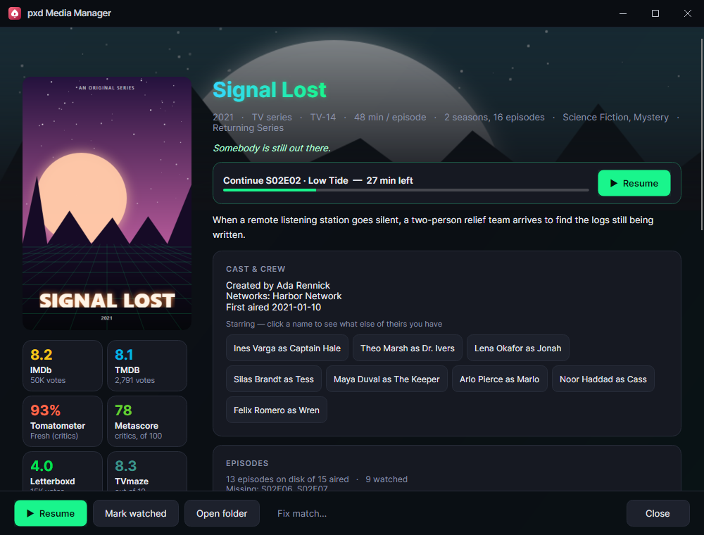
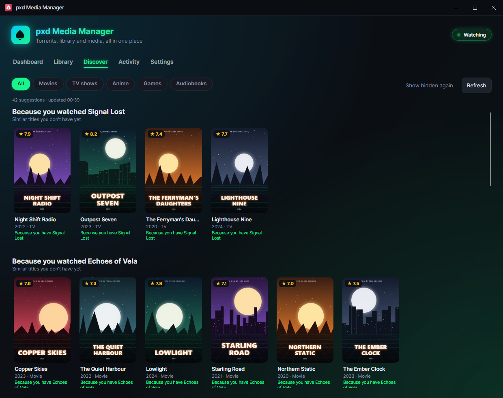
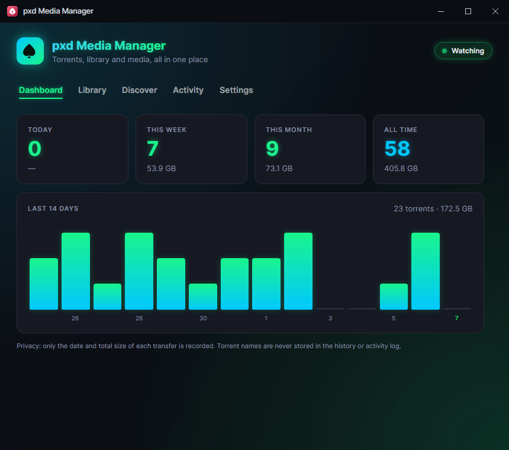
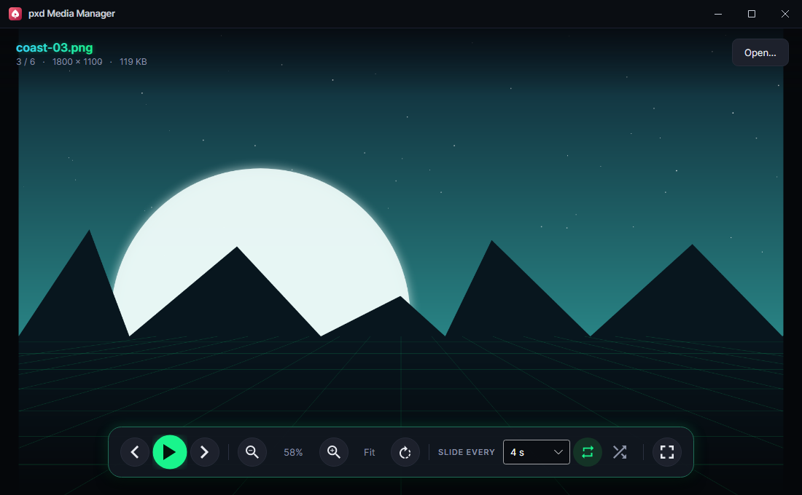

# pxd Media Manager

**Your downloads, your media library and a video and picture player, in one desktop app.**

pxd Media Manager sits in the tray and keeps things tidy: it sends new `.torrent` files to the folder or NAS share your torrent client watches, moves finished downloads into the right category folder, and turns those folders into a poster library with ratings, details, episode tracking and recommendations. When you want to watch something, it plays videos and pictures in its own viewer.



<sub>All screenshots use a made-up sample library: invented titles and generated artwork.</sub>

## Contents

- [Features](#features)
- [Screenshots](#screenshots)
- [Supported systems](#supported-systems)
- [Install](#install)
- [Optional API keys](#optional-api-keys)
- [Keyboard shortcuts](#keyboard-shortcuts)
- [Where your data lives](#where-your-data-lives)
- [Build from source](#build-from-source)
- [Code layout](#code-layout)

## Features

### Downloads
- **Torrent watcher.** Watches your Downloads folder and copies new `.torrent` files to a folder or network share your torrent client watches. It waits for the browser to finish writing the file without opening it, because opening it breaks Firefox downloads.
- **Categories and auto-move.** Pick a category (Movies, TV, Games…) when a torrent arrives, and the finished download is moved to that category's folder, with a progress overlay and an optional "it's arrived" notice showing the poster and a Play button.
- **Dashboard** with today / week / month / all-time totals and a 14-day chart. Only dates and sizes are recorded, never torrent names.
- **Several PCs, one setup.** Optional shared settings file and merged stats through a shared folder (Windows and Linux). Each PC writes only its own stats file, so they never conflict, and a local copy of the settings is kept for when the share is offline.

### Library
- **Poster grid or carousel** for each category, with search, sort, filters (shelf, genre, decade, resolution, rating), "Surprise me", a stats window and a duplicate finder.
- **TV shows grouped automatically** from episode files and season folders, with watched ticks and progress bars.
- **Artwork and details** from your own folder images (`poster.jpg`, `folder.jpg`, `cover.jpg`…), or from online sources:
  - Movies and TV: [TMDB](https://www.themoviedb.org/), plus ratings from OMDb (IMDb, Rotten Tomatoes, Metacritic), MDBList and TVmaze
  - Anime scores: AniList
  - Games: Steam
  - Audiobooks: Audible
  - Subtitles: OpenSubtitles
- **Details window**: backdrop, rating badges, cast you can click through, trailer, media specs read from the file itself (resolution, codecs, audio and subtitle tracks), an episode list showing missing and upcoming episodes, and resume / next up.
- **Fix match** when a title is recognised wrongly. Everything looked up is cached on disk, so each title is fetched only once.
- **Discover tab**: recommendations based on what you own and watch ("Because you watched…"), trending titles, anime, games for your favourite genres, and audiobooks by authors and series you already have.

### Viewer
- **Video player** (LibVLC): seek, volume, speed, audio and subtitle tracks, auto-next, and it remembers where you stopped.
- **Picture viewer**: zoom, pan, rotate, fit, and a slideshow with speed, loop and shuffle.
- Opens from the library, the details window or the tray ("Open media…"), one window per item.

### Everywhere
- **Works with [pxd Toolkit](https://github.com/joshpack/pxdToolkit)**, which can open the app and turn its tray icon on or off (the same switch is in **Settings → Tray icon**). With the icon hidden the app keeps running; start it again to bring its window back. Every window has the pxd title bar and opens where you last left it.

## Screenshots

| | |
| --- | --- |
|  |  |
| **Details**: ratings, cast, and specs read from the file | **Series**: episodes on disk, watched, missing and upcoming |
|  |  |
| **Discover**: suggestions from what you own and watch | **Dashboard**: totals, a 14-day chart and downloads waiting to be moved |
|  | |
| **Picture viewer**: zoom, rotate and slideshow | |

## Supported systems

| System | Status | Download | Notes |
| --- | --- | --- | --- |
| **Windows 10 / 11, x64** | Supported, tested on Windows 11 | Setup or portable zip | Everything included: no .NET or VLC install needed. |
| **Linux, x64** | Works, lightly tested | `.tar.gz` (this build itself is untested) | Needs VLC from your package manager for video and media info. The tray icon needs a desktop with tray (StatusNotifier) support. |
| **macOS** | Untested, no download | Build from source | The video player and media info won't work as-is: the project bundles VLC only for Windows. |
| Windows on ARM, Linux ARM | Not built | Build from source | Untested. |

The app is written once for all three systems ([Avalonia](https://avaloniaui.net/) on .NET 10), and the code has Linux and macOS paths for start-at-login, opening folders, the Trash and `smb://` shares. Windows is where it's used every day.

## Install

Downloads are on the [latest release](https://github.com/joshpack/pxdMediaManager/releases/latest). Each file has a matching `.sha256` checksum.

| File | What it is |
| --- | --- |
| `pxdMediaManager-1.2.0-win-x64-setup.exe` | Windows installer (recommended) |
| `pxdMediaManager-1.2.0-win-x64-portable.zip` | Windows, no install: unzip and run |
| `pxdMediaManager-1.2.0-linux-x64.tar.gz` | Linux x64 (untested build) |

### Windows (setup)

1. Download `pxdMediaManager-1.2.0-win-x64-setup.exe` and run it.
2. It installs for your user only, so it doesn't ask for administrator rights. It puts the app in `%LOCALAPPDATA%\Programs\pxd Media Manager`, adds a Start menu shortcut (and a desktop one if you tick it) and an entry in **Settings → Apps → Installed apps**.
3. The app starts in the tray. The first time, its window opens so you can pick your folders.

The setup isn't code-signed, so SmartScreen may warn about it: choose **More info → Run anyway**. You can check the download against its `.sha256` file first:

```powershell
(Get-FileHash .\pxdMediaManager-1.2.0-win-x64-setup.exe -Algorithm SHA256).Hash
```

**Silent install** (Start menu shortcut, no desktop shortcut):

```powershell
Start-Process .\pxdMediaManager-1.2.0-win-x64-setup.exe -ArgumentList '--quiet' -Wait
# into another folder:
Start-Process .\pxdMediaManager-1.2.0-win-x64-setup.exe -ArgumentList '--quiet','--dir','D:\Apps\pxd Media Manager' -Wait
```

| Setup option | What it does |
| --- | --- |
| *(none)* | The setup window |
| `--quiet [--dir FOLDER]` | Installs without a window; exit code 0 on success, 1 on failure. Without `--dir` it reuses the existing install folder, or the default one. |
| `--unpack FOLDER` | Only puts the app's files in `FOLDER`: no shortcuts, no Apps entry (a portable copy) |

**Updating:** run the newer setup. It closes the running copy, replaces the files and keeps your settings.

**Uninstall:** **Settings → Apps → Installed apps → pxd Media Manager → Uninstall**, or run `uninstall.cmd` in the install folder. That removes the app, its shortcuts, the Apps entry and start-at-login. Your settings and caches in `%APPDATA%\pxdMediaManager` are kept in case you reinstall; delete that folder to remove them too.

### Windows (portable)

Unzip `pxdMediaManager-1.2.0-win-x64-portable.zip` anywhere and run `pxdMediaManager\pxdMediaManager.exe`. Nothing is registered. To remove it, quit it from the tray and delete the folder (and `%APPDATA%\pxdMediaManager` for the settings).

### Linux (x64)

Install VLC first (the app uses the system's `libvlc` for video and media info):

```bash
sudo apt install vlc          # Debian, Ubuntu, Mint
sudo dnf install vlc          # Fedora (VLC comes from RPM Fusion)
sudo pacman -S vlc            # Arch
```

Then unpack and run:

```bash
mkdir -p ~/.local/opt
tar -xzf pxdMediaManager-1.2.0-linux-x64.tar.gz -C ~/.local/opt
~/.local/opt/pxdMediaManager/pxdMediaManager --show
```

It's self-contained, so no .NET install is needed. **Start at login** in Settings writes `~/.config/autostart/torrent-monitor.desktop`. On GNOME the tray icon needs the AppIndicator extension; without a tray, start it with `--show` so the window opens. Category and target folders can be `smb://` addresses; they're mounted through KIO FUSE (KDE) or GVfs (GNOME and others).

To uninstall, turn off **Start at login**, then delete `~/.local/opt/pxdMediaManager` and, for the settings, `~/.config/pxdMediaManager`.

This Linux build hasn't been tested yet. If something doesn't work, please open an issue.

### macOS

There's no download. You can [build from source](#build-from-source) and run it with `dotnet run`, but it's untested, and video playback and media info won't work until the macOS VLC package is added to the project.

## Optional API keys

Everything works without keys: titles then show your own folder images, or generated art. With keys, the library gets posters, details, ratings and recommendations. Paste them in **Settings**. They're stored on this PC only and never written to the shared settings file.

| Key | What it adds | Where to get it (free) |
| --- | --- | --- |
| **TMDB** | Posters, backdrops, details, cast, episode lists, Discover recommendations for movies and TV | [themoviedb.org](https://www.themoviedb.org/settings/api): sign in → Settings → API. Either the **API key** or the **API Read Access Token** works. |
| **OMDb** | IMDb, Rotten Tomatoes and Metacritic ratings, awards, box office | [omdbapi.com](https://www.omdbapi.com/apikey.aspx) → API Key (1,000 lookups a day). Needs the TMDB key too. |
| **MDBList** | More ratings: Trakt, Letterboxd, RT audience, Metacritic users, Roger Ebert, MyAnimeList… | [mdblist.com](https://mdblist.com/) → sign in → Preferences → API key. Needs the TMDB key too. |
| **OpenSubtitles** | "Find subtitles" in the details window, saved next to the video | [opensubtitles.com](https://www.opensubtitles.com/) → profile → API consumers → New consumer. |

No key is needed for Steam (games), Audible (audiobooks), AniList (anime scores) or TVmaze (TV ratings). Each **Test** button in Settings checks a key without looking anything up.

What gets sent: titles (and years) from your Movies and TV categories go to TMDB to find a match, IMDb IDs go to OMDb, and so on. Answers are cached on disk, so each title is looked up once.

## Keyboard shortcuts

### Video and picture viewer

| Key | Pictures | Videos |
| --- | --- | --- |
| `Space` | Start / pause slideshow | Play / pause |
| `←` / `→` | Previous / next picture | Back / forward 5 s (`Shift`: 30 s) |
| `↑` / `↓` | Zoom in / out | Volume up / down |
| `+` / `-` | Zoom in / out | |
| `0` / `1` | Fit to window / actual size | |
| `R` | Rotate 90° | |
| `[` / `]` | Slideshow slower / faster | |
| `N` / `P` | Next / previous picture | Next / previous video |
| `Home` / `End` | First / last picture | Restart from the beginning / last video |
| `M` | | Mute |
| `F` or `F11` | Full screen | Full screen |
| `Esc` | Leave full screen, or stop the slideshow | Leave full screen |
| `Ctrl+O` | Open a file | Open a file |

With a video, double-click toggles full screen and the mouse wheel changes the volume.

### Library

In the carousel, `←` / `→` move through titles, `Home` / `End` jump to the first / last, and `Enter` opens the details. `Esc` closes the details, stats and duplicates windows.

### Command line

`pxdMediaManager --show` opens the window at start-up instead of starting in the tray. Starting the app while it's already running opens the running copy's window.

`pxdMediaManager --self-test [FOLDER]` runs checks without opening a window or touching your settings (settings-folder and start-at-login moves from the app's earlier names, the pxd Toolkit link) and writes `report.txt` to FOLDER (default: a temp folder). The exit code is 0 when every check passed.

## Where your data lives

| | Windows | Linux / macOS |
| --- | --- | --- |
| Settings, caches, watch history | `%APPDATA%\pxdMediaManager` | `~/.config/pxdMediaManager` (or under `$XDG_CONFIG_HOME`) |
| The installed app | `%LOCALAPPDATA%\Programs\pxd Media Manager` | wherever you unpacked it |
| Start at login | `HKCU\Software\Microsoft\Windows\CurrentVersion\Run`, value `pxdMediaManager` | `~/.config/autostart/torrent-monitor.desktop` (Linux), `~/Library/LaunchAgents/com.torrentmonitor.app.plist` (macOS) |

The settings folder holds `settings.json`, `watch-history.json`, `stats.json`, `viewer.json`, `windows.json` (where each window was left) and caches (`posters/`, `matches/`, `details/`, `ratings/`, …). Deleting the caches is safe; they're rebuilt as needed. If you use a shared settings folder, it holds `torrentmonitor-settings.json` and one `stats-<machine>.json` per PC. (The "torrentmonitor" names come from the app's old name and are kept so older installs keep working.)

When you update from a version that had an earlier name, the app moves its settings folder and its start-at-login entry to the new name the first time it starts, and the setup program replaces the earlier install's shortcuts, Apps entry and folder. Nothing needs doing by hand.

Set the `PXDMM_DATA_DIR` environment variable to keep all of this in another folder instead, e.g. for testing.

## Build from source

You need the [.NET 10 SDK](https://dotnet.microsoft.com/download).

```bash
git clone https://github.com/joshpack/pxdMediaManager.git
cd pxdMediaManager
dotnet run -- --show
```

Release builds:

```bash
# Windows, self-contained (what the portable zip contains)
dotnet publish -c Release -r win-x64 --self-contained true -p:DebugType=none -o publish/win-x64

# Linux, self-contained (then delete publish/linux-x64/libvlc: it holds Windows-only VLC files)
dotnet publish -c Release -r linux-x64 --self-contained true -p:DebugType=none -o publish/linux-x64
```

Publish it as a folder, not a single file: the video player's and renderer's native libraries have to be real files.

**Installer:** `installer\build-setup.ps1 [-Version 1.0.0]` publishes the app, packs it into the setup program (`installer\Setup`) and writes `%LOCALAPPDATA%\pxdMediaManager\installer\pxd-media-manager-setup.exe` plus a `.sha256`. The version defaults to `<Version>` in `installer\Setup\pxdMediaManager.Setup.csproj`. Release assets are renamed to `pxdMediaManager-<version>-win-x64-setup.exe`.

**Testing against stand-in servers:** every online source can be pointed elsewhere with an environment variable, so tests never need real keys: `TORRENTMONITOR_TMDB_API`, `TORRENTMONITOR_TMDB_IMAGES`, `PXDMM_OMDB_API`, `PXDMM_MDBLIST_API`, `PXDMM_TVMAZE_API`, `PXDMM_STEAM_API`, `PXDMM_STEAMSPY_API`, `PXDMM_AUDIBLE_API`, `PXDMM_ANILIST_API`, `PXDMM_OPENSUBTITLES_API`. Combine them with `PXDMM_DATA_DIR` to keep test data away from your real settings.

## Code layout

| Path | What's there |
| --- | --- |
| `Program.cs`, `App.axaml(.cs)` | Start-up, single-instance guard, tray icon and menu |
| `pxdStandard.cs`, `AppChrome.cs`, `Services/ToolkitLink.cs` | The pxd App Standard: title bar, remembered window placement, pxd Toolkit link (tray icon on/off), opening the running copy |
| `Services/` | Torrent watcher, auto-mover, stats, settings (local and shared), library scanner, metadata clients (TMDB, OMDb, MDBList, TVmaze, Steam, Audible, AniList, OpenSubtitles), Discover, watch history, media specs, data folder (`AppPaths`) |
| `Views/` | Main window (Dashboard, Library, Discover, Activity, Settings), details window, match / choice / batch dialogs, progress overlay, arrival notice |
| `Viewer/` | The video and picture viewer window, the LibVLC player and the zoomable image stage |
| `installer/` | `build-setup.ps1` and the setup program (`Setup/`) |
| `docs/screenshots/` | The pictures in this README |

Built with [Avalonia](https://avaloniaui.net/) 12 and [LibVLCSharp](https://code.videolan.org/videolan/LibVLCSharp) on .NET 10.

This product uses the TMDB API but is not endorsed or certified by TMDB.
